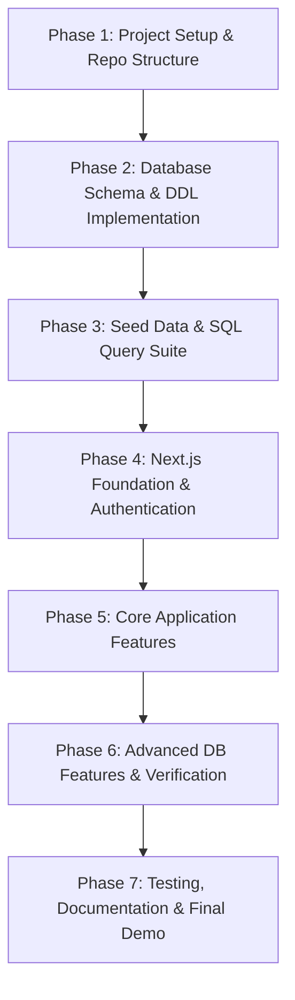

# Scholarly — Project Execution Plan

> **Course**: DBMS Experiential Learning — Level 3 Project (PES University)  
> **Tech Stack**: Next.js (Fullstack App Router), PostgreSQL (`pgvector`), Tailwind/CSS, TypeScript  
> **Your Module**: Core Platform (Identity, Affiliations, Conferences, Papers & Topics)

---

## 1. Project Overview & Scope Alignment

The project is an academic peer-review management system (**Scholarly**). The system contains 20 relational tables, pgvector embeddings, and full-text search.

Your assigned responsibility covers the **Core Platform & Submissions Pipeline**, consisting of **12 core tables**:
1. **Identity & Profiles**: `PEOPLE`, `USER_ACCOUNTS`, `AUTHOR_PROFILES`, `REVIEWER_PROFILES`
2. **Affiliations**: `AFFILIATIONS`, `PERSON_AFFILIATIONS`
3. **Conferences**: `CONFERENCES`, `CONFERENCE_MEMBERSHIPS`
4. **Papers & Authors**: `PAPERS`, `PAPER_AUTHORS`
5. **Topics**: `TOPICS`, `PAPER_TOPICS`

Your teammate covers the **Review & Evaluation Pipeline** (Assignments, Reviews, Decisions, Reviewer Topics/Embeddings, COIs, Audit).

---

## 2. Phased Action Plan

---

### Phase 1: Environment & Repository Scaffold
- [ ] Initialize Next.js project inside the repository (`create-next-app` with TypeScript, Tailwind CSS, App Router).
- [ ] Setup database connection pooling using `pg` (node-postgres) with parameterized queries for safety and direct SQL grading visibility.
- [ ] Configure environment variables in `.env.local` and create `.env.example`:
  - `DATABASE_URL` / `PGHOST`, `PGPORT`, `PGUSER`, `PGPASSWORD`, `PGDATABASE`
  - `JWT_SECRET` / session configuration
- [ ] Setup SQL migration/scripts directory structure:
  - `db/schema/` (DDL scripts)
  - `db/seeds/` (Sample data)
  - `db/queries/` (Advanced SQL queries, reports)
  - `db/procedures/` (Triggers, functions, views)
  - `db/tests/` (Constraint validation test cases)

---

### Phase 2: Database Design & Schema Implementation (Your 12 Tables)

Translate the ER diagram and relational schema into clean, robust PostgreSQL DDL with strict integrity constraints:

#### 1. Identity & Profiles
- `PEOPLE`:
  - Primary Key: `person_id BIGSERIAL`
  - Columns: `full_name VARCHAR(200) NOT NULL`, `email CITEXT NOT NULL UNIQUE`, `created_at TIMESTAMPTZ DEFAULT NOW()`
  - Extension: `CREATE EXTENSION IF NOT EXISTS citext;`
- `USER_ACCOUNTS`:
  - Primary Key: `account_id BIGSERIAL`
  - Foreign Key: `person_id BIGINT UNIQUE NOT NULL REFERENCES PEOPLE(person_id) ON DELETE CASCADE`
  - Constraints: `CHECK (system_role IN ('admin', 'user'))`, `CHECK (account_status IN ('active', 'suspended', 'pending'))`
  - Columns: `password_hash TEXT NOT NULL`, `created_at`, `last_login_at`
- `AUTHOR_PROFILES`:
  - Primary Key & Foreign Key: `person_id BIGINT PRIMARY KEY REFERENCES PEOPLE(person_id) ON DELETE CASCADE`
  - Columns: `profile_status VARCHAR(20) DEFAULT 'active' NOT NULL`
- `REVIEWER_PROFILES`:
  - Primary Key & Foreign Key: `person_id BIGINT PRIMARY KEY REFERENCES PEOPLE(person_id) ON DELETE CASCADE`
  - Columns: `bio TEXT`, `research_keywords TEXT`, `reviewer_status VARCHAR(20) DEFAULT 'active' NOT NULL`, `created_at TIMESTAMPTZ`

#### 2. Affiliations
- `AFFILIATIONS`:
  - Primary Key: `affiliation_id BIGSERIAL`
  - Columns: `institution_name VARCHAR(250) NOT NULL`, `institution_domain VARCHAR(150)`, `country_code CHAR(2)`
- `PERSON_AFFILIATIONS`:
  - Composite Primary Key: `(person_id, affiliation_id, start_date)`
  - Foreign Keys: `person_id REFERENCES PEOPLE(person_id)`, `affiliation_id REFERENCES AFFILIATIONS(affiliation_id)`
  - Constraints: `CHECK (end_date IS NULL OR end_date >= start_date)`

#### 3. Conferences
- `CONFERENCES`:
  - Primary Key: `conference_id BIGSERIAL`
  - Columns: `name VARCHAR(200) NOT NULL`, `acronym VARCHAR(20) NOT NULL`, `year SMALLINT NOT NULL`, `description TEXT`, `submission_open_at TIMESTAMPTZ NOT NULL`, `submission_close_at TIMESTAMPTZ NOT NULL`, `review_deadline TIMESTAMPTZ NOT NULL`, `status VARCHAR(20) NOT NULL DEFAULT 'draft'`, `created_at TIMESTAMPTZ DEFAULT NOW()`
  - Constraints: `UNIQUE (acronym, year)`, `CHECK (submission_close_at > submission_open_at)`, `CHECK (review_deadline > submission_close_at)`
- `CONFERENCE_MEMBERSHIPS`:
  - Composite Primary Key: `(conference_id, person_id, role)`
  - Foreign Keys: `conference_id REFERENCES CONFERENCES(conference_id) ON DELETE CASCADE`, `person_id REFERENCES PEOPLE(person_id) ON DELETE CASCADE`
  - Constraints: `CHECK (role IN ('chair', 'author', 'reviewer', 'pc_member'))`, `CHECK (max_active_assignments IS NULL OR (role = 'reviewer' AND max_active_assignments >= 0))`

#### 4. Papers and Authors
- `PAPERS`:
  - Primary Key: `paper_id BIGSERIAL`
  - Foreign Keys: `conference_id REFERENCES CONFERENCES(conference_id) ON DELETE RESTRICT`, `created_by_person_id REFERENCES PEOPLE(person_id)`
  - Columns: `title VARCHAR(300) NOT NULL`, `abstract TEXT NOT NULL`, `submission_status VARCHAR(20) NOT NULL DEFAULT 'submitted'`, `submitted_at TIMESTAMPTZ DEFAULT NOW()`, `updated_at TIMESTAMPTZ DEFAULT NOW()`, `search_vector TSVECTOR`
  - Constraints: `CHECK (submission_status IN ('draft', 'submitted', 'under_review', 'accepted', 'rejected', 'withdrawn'))`
  - Text search trigger/generated column for `search_vector`.
- `PAPER_AUTHORS`:
  - Composite Primary Key: `(paper_id, author_person_id)`
  - Foreign Keys: `paper_id REFERENCES PAPERS(paper_id) ON DELETE CASCADE`, `author_person_id REFERENCES PEOPLE(person_id) ON DELETE RESTRICT`
  - Constraints: `author_order SMALLINT NOT NULL CHECK (author_order >= 1)`, `is_corresponding BOOLEAN NOT NULL DEFAULT FALSE`
  - Constraint: `UNIQUE (paper_id, author_order) DEFERRABLE INITIALLY DEFERRED`

#### 5. Topics
- `TOPICS`:
  - Primary Key: `topic_id BIGSERIAL`
  - Columns: `topic_name VARCHAR(100) NOT NULL UNIQUE`, `description TEXT`
- `PAPER_TOPICS`:
  - Composite Primary Key: `(paper_id, topic_id)`
  - Foreign Keys: `paper_id REFERENCES PAPERS(paper_id) ON DELETE CASCADE`, `topic_id REFERENCES TOPICS(topic_id) ON DELETE RESTRICT`

---

### Phase 3: SQL Operations, Queries & Advanced Database Concepts

Deliverables required by rubric:
- [ ] **DML Script**: Realistic sample data inserted (10+ people, accounts, affiliations, 3+ conferences, 15+ topics, 10+ papers with multi-author and multi-topic relations).
- [ ] **Standard CRUD Demonstration**: Tested scripts for `INSERT`, `SELECT`, `UPDATE`, `DELETE`.
- [ ] **Complex Analytical Queries**:
  - `JOIN` across 4+ tables (e.g. Conference -> Paper -> Paper_Authors -> People -> Affiliation).
  - `GROUP BY` + `HAVING` + aggregate functions (e.g. Conferences with > 3 accepted submissions, average author count per paper).
  - Subqueries (correlated and non-correlated, e.g. finding authors who submitted to multiple distinct conferences in the same year).
- [ ] **Advanced Database Features (Satisfying the 4 SQL + 1 Vector/FTS requirement)**:
  1. **Transactions (ACID)**: Multi-table paper submission transaction (`BEGIN ... INSERT INTO PAPERS ... INSERT INTO PAPER_AUTHORS ... INSERT INTO PAPER_TOPICS ... COMMIT;`).
  2. **Triggers & Functions**:
     - Auto-updating `updated_at` timestamps.
     - Enforcing exactly one corresponding author per paper.
     - Updating `search_vector` TSVECTOR for Full-Text Search.
  3. **Views**: `v_paper_summary` (aggregating paper metadata, corresponding author name, co-authors list as JSON/array, and assigned topic names).
  4. **Indexes**: B-tree on foreign keys and compound lookups, GIN index on `PAPERS.search_vector`.
  5. **Full-Text / Vector Search**: Keyword search query using `to_tsquery` or semantic similarity matching with `pgvector` on paper titles/abstracts.

---

### Phase 4: Next.js Full-Stack Application Setup & Authentication

- [ ] **App Structure**:
  - `app/` (Next.js 14/15 App Router)
  - `app/api/auth/` (Register, Login, Session, Logout)
  - `app/api/conferences/` (List, details)
  - `app/api/papers/` (Submission endpoint, author papers)
  - `app/api/topics/` (Topic listing for dropdown/multiselect)
  - `lib/db.ts` (PostgreSQL client pool)
  - `lib/auth.ts` (JWT / session cookie encryption & password hashing via `bcryptjs`)
- [ ] **Authentication & Authorization**:
  - Role-based access control (`admin`, `author`/`user`).
  - Protected route middleware: redirect unauthenticated users to `/login`.
  - Registration handles atomic creation in `PEOPLE`, `USER_ACCOUNTS`, and default `AUTHOR_PROFILES`.

---

### Phase 5: Core Application Features & Pages

- [ ] **Navigation & Premium UI Theme**: Sleek dark/light theme, modern typography (Inter), responsive navigation bar with auth state.
- [ ] **Conference Listing (`/conferences`)**:
  - Displays all active conferences, submission deadlines, acceptance status, and call-for-papers.
  - Search and filter by year, status, or keyword.
- [ ] **Conference Details (`/conferences/[id]`)**:
  - Key dates (submission open/close, review deadline).
  - List of topics covered.
  - "Submit Paper" action button (enabled only when submission window is open).
- [ ] **Paper Submission Flow (`/conferences/[id]/submit`)**:
  - Multi-author input: dynamically add co-authors by email or name with order specification.
  - Multi-topic selection: multi-select badges/checkboxes for topics.
  - Form validation: client-side checks + atomic server-side PostgreSQL transaction.
- [ ] **Author Dashboard (`/dashboard`)**:
  - Displays all papers submitted by the logged-in user.
  - Badges for submission status (`submitted`, `under_review`, `accepted`, `rejected`).
  - Co-author list, topics list, submission date, and conference link.
  - Option to view details or withdraw a submission.

---

### Phase 6: Constraint Validation Testing & Negative Tests

Script and document test cases where the database rejects invalid operations:
- [ ] Duplicate email in `PEOPLE` -> `UNIQUE` violation.
- [ ] Submission close date earlier than open date in `CONFERENCES` -> `CHECK` constraint violation.
- [ ] Adding a paper author pointing to non-existent `person_id` -> `FOREIGN KEY` violation.
- [ ] Duplicate `author_order` on the same paper -> `UNIQUE (paper_id, author_order)` violation.
- [ ] Deleting a conference with existing papers -> `ON DELETE RESTRICT` integrity failure.

---

### Phase 7: Documentation, Demonstration Artifacts & Git Hand-off

- [ ] **Data Dictionary**: Document every column, data type, nullability, keys, and constraints for all 12 tables.
- [ ] **Relational Schema & ER Diagram Documentation**: Include the finalized diagrams matching Scholarly.
- [ ] **Query Execution Logs**: Save CLI output of all test queries, joins, and constraint validations.
- [ ] **Application Walkthrough & Screenshots**: High-resolution screenshots of Register/Login, Conference List, Submission form, and Author Dashboard.
- [ ] **README**: Clean instructions on setting up PostgreSQL, running DDL scripts, seeding data, and starting `npm run dev`.
- [ ] **Structured Git Commits**:
  - `feat(db): create initial DDL schema for 12 core tables and constraints`
  - `feat(db): add triggers, views, and seed data`
  - `feat(auth): implement user registration, login, and session handling`
  - `feat(ui): build conference browsing and details pages`
  - `feat(papers): implement multi-author and multi-topic submission with ACID transaction`
  - `feat(dashboard): implement author submission tracking dashboard`
  - `docs: add data dictionary, test results, and setup guide`
