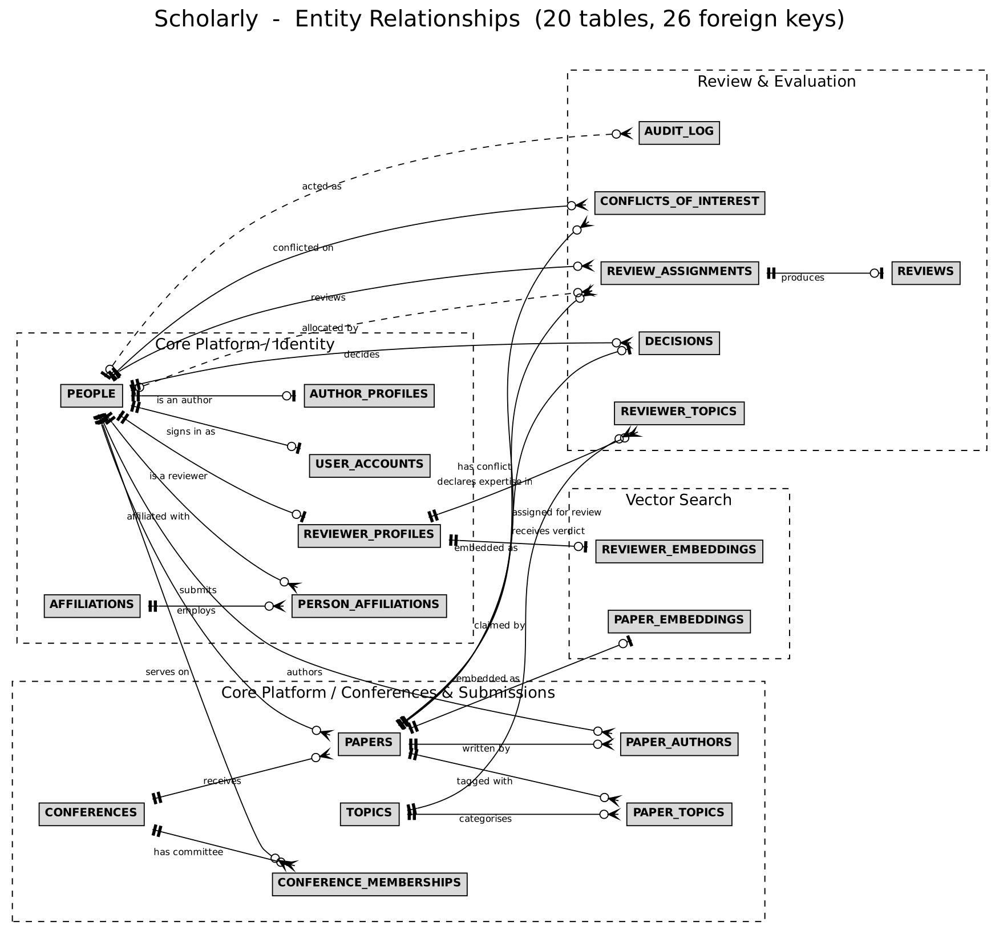

# Scholarly — A Conflict-Aware Peer Review Management System

DBMS Experiential Learning, Level 3 Project — PES University

Conferences receive hundreds of papers that must be matched to qualified, unbiased
reviewers. Done by hand, conflicts of interest get missed and reviewer workloads end
up uneven.

Scholarly is a PostgreSQL database that manages the whole review cycle: submission,
conflict detection, reviewer assignment, review collection and final decision. The
schema is normalised to BCNF and models the many-to-many links between authors and
papers, reviewers and topics, and reviewers and assignments. A Next.js application
sits on top of it.

**The database does the enforcement, not the application.**

- Triggers flag conflicts of interest from co-authorship and shared affiliation, and
  block any assignment that violates one.
- A stored procedure assigns *k* reviewers per paper, avoiding conflicts, matching
  expertise and balancing load.
- Views enforce double-blind rules so each role sees only what it should.
- A row lock inside the workload trigger keeps reviewer limits intact under
  concurrent assignment.
- Analytical queries surface reviewer disagreement, scoring bias and papers with no
  eligible expert.

Tested on a synthetic set of 200 papers and 50 reviewers.

---

## Repository Layout

```
db/
  schema/
    01_core_tables.sql          12 core tables: identity, conferences, papers, topics
    06_vector_embeddings.sql    pgvector embedding tables + HNSW indexes
    08_review_tables.sql        6 review tables: expertise, COI, assignments,
                                reviews, decisions, audit
  procedures/
    02_advanced_features.sql    submission triggers, sp_submit_paper, author view
    09_review_features.sql      COI detection, assignment procedure, workload
                                enforcement, double-blind views, audit triggers
  seeds/
    03_seed_data.sql            small hand-written demonstration dataset
    07_vector_seed_and_test.sql embedding seed and similarity test
    10_review_seed_data.sql     200 papers / 50 reviewers synthetic dataset
  queries/
    05_demonstration_queries.sql  core platform queries
    11_review_analytics.sql       disagreement, bias, coverage, audit analytics
  tests/
    04_constraint_tests.sql       core platform negative tests
    12_review_constraint_tests.sql review pipeline negative tests (15)
    13_concurrency_test.sh        two-session reviewer quota race test
  tools/
    generate_schema_docs.py     introspects a live database to emit the ER
                                diagram and relational schema
    capture_execution_logs.sh   rebuilds the database and saves all CLI output
    capture_screenshots.js      drives the running app to capture the walkthrough
docs/
  TECHNICAL_DOCUMENTATION.md       Core Platform module
  REVIEW_PIPELINE_DOCUMENTATION.md Review & Evaluation module
  RELATIONAL_SCHEMA.md             relational schema + full data dictionary
  erd_overview.{png,svg,dot,mmd}   ER diagram, relationships only
  erd_full.{png,svg,dot,mmd}       ER diagram, every table and column
  logs/                            captured execution output of every script
  screenshots/                     application walkthrough
src/                               Next.js application (App Router, TypeScript)
```

The numeric prefixes are the execution order.

---

## Entity Relationship Diagram



Twenty tables, twenty-six foreign keys, in crow's foot notation and grouped by
module. `docs/erd_full.png` is the same diagram with every column, data type and
key marker.

Both diagrams and `docs/RELATIONAL_SCHEMA.md` are **generated by introspecting a
live database**, not drawn by hand, so they cannot drift from the schema:

```bash
python3 db/tools/generate_schema_docs.py scholarly
dot -Tpng -Gdpi=130 docs/erd_full.dot -o docs/erd_full.png
```

## Demonstration Artifacts

| Artifact | Location |
| :--- | :--- |
| Relational schema and data dictionary | `docs/RELATIONAL_SCHEMA.md` |
| ER diagrams | `docs/erd_overview.*`, `docs/erd_full.*` |
| Execution logs for every script | `docs/logs/` |
| Application screenshots | `docs/screenshots/` |

Regenerate the logs at any time with `./db/tools/capture_execution_logs.sh`,
which rebuilds the database from scratch and captures the real CLI output.

---

## Module Split

| Module | Owner | Tables |
| :--- | :--- | :--- |
| Core Platform — identity, affiliations, conferences, papers, topics | Riddhi Mundada | 12 |
| Review & Evaluation — expertise, conflicts, assignments, reviews, decisions, audit | Sanchita Sunil | 6 |
| Vector embeddings | Core Platform | 2 |

20 tables in total.

---

## Prerequisites

- PostgreSQL 14 or later (developed and verified on 16.15)
- Node.js 18 or later
- The `citext` extension (ships with PostgreSQL)
- The `vector` extension (pgvector), **optional** — only needed for
  `06_vector_embeddings.sql` and `07_vector_seed_and_test.sql`. Everything else runs
  without it.

---

## Database Setup

```bash
# 1. Create the database
createdb scholarly

# 2. Core platform: schema, triggers and procedures, demonstration data
psql -d scholarly -f db/schema/01_core_tables.sql
psql -d scholarly -f db/procedures/02_advanced_features.sql
psql -d scholarly -f db/seeds/03_seed_data.sql

# 3. Core platform queries and constraint tests
psql -d scholarly -f db/queries/05_demonstration_queries.sql
psql -d scholarly -f db/tests/04_constraint_tests.sql

# 4. Vector embeddings (skip if pgvector is not installed)
psql -d scholarly -f db/schema/06_vector_embeddings.sql
psql -d scholarly -f db/seeds/07_vector_seed_and_test.sql

# 5. Review pipeline: schema, logic, synthetic dataset
psql -d scholarly -f db/schema/08_review_tables.sql
psql -d scholarly -f db/procedures/09_review_features.sql
psql -d scholarly -f db/seeds/10_review_seed_data.sql

# 6. Review pipeline analytics and tests
psql -d scholarly -f db/queries/11_review_analytics.sql
psql -d scholarly -f db/tests/12_review_constraint_tests.sql
./db/tests/13_concurrency_test.sh scholarly
```

Steps 3, 6 and the constraint tests print `PASSED` / `FAILED` notices. All tests are
expected to pass.

`10_review_seed_data.sql` is idempotent and can be re-run; it clears its own
conference before reloading.

---

## Application Setup

Create `.env.local` in the repository root:

```bash
PGHOST=localhost
PGPORT=5432
PGUSER=your_postgres_user
PGPASSWORD=your_postgres_password
PGDATABASE=scholarly
JWT_SECRET=replace_with_a_long_random_string
```

Then:

```bash
npm install
npm run dev
```

The app runs at http://localhost:3000.

Seeded accounts all use the password `Password123!`. For example
`alice@mit.edu` (admin) or `bob@stanford.edu` (user).

---

## What to Look At

If you are marking this or reviewing it, the parts worth reading are:

1. **`db/procedures/09_review_features.sql`** — the conflict detection rules, the
   assignment procedure, and the `SELECT ... FOR UPDATE` that makes the reviewer
   quota concurrency-safe.
2. **`db/queries/11_review_analytics.sql` Q2** — reviewer scoring bias, computed by
   comparing each review to the mean of the other reviewers on the same paper, which
   controls for paper quality.
3. **`db/tests/13_concurrency_test.sh`** — two real sessions racing for the last slot
   in a reviewer's quota; exactly one wins.
4. **`docs/REVIEW_PIPELINE_DOCUMENTATION.md` section 11** — the known limitations,
   written honestly rather than omitted.
